# Lies of P · DirectX 11 5인 팀 프로젝트

> C++과 DirectX 11로 제작한 **P의 거짓 모작 팀 프로젝트**입니다. 애니메이션·UI 편집 도구와 런타임을 담당하고, 편집 데이터를 실제 캐릭터 동작과 게임 화면에 연결했습니다.

## 개요

**프로젝트 형태:** 3D 액션 RPG 모작 · 팀 프로젝트 
**개발 기간:** 2026.06 ~ 2026.08(약 2개월) 
**담당:** 애니메이션 에디터·Animator / UI 에디터·런타임 / 게임 UI 연동 
**개발 환경:** C++ · DirectX 11 · HLSL · ImGui · JSON · FMOD 
**전체 시연 영상:** [YouTube에서 보기](https://youtu.be/_5pHLyo4vUw)

캐릭터 동작의 프레임 구간과 재생 규칙, UI의 배치와 연결 정보를 에디터에서 설정하고 게임에서 사용할 수 있도록 구현했습니다. 팀원들이 편집 결과를 미리 확인하고 런타임에 적용할 수 있도록 프리뷰와 사용 설명서도 함께 정리했습니다.

## 하이라이트

<table>
  <tr>
    <td width="50%" align="center"><b>애니메이션 에디터</b> 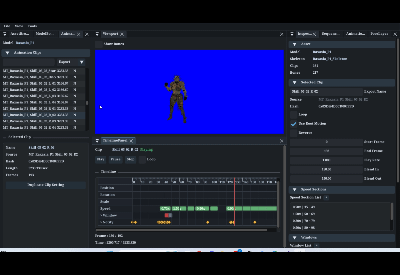 클립·프레임 구간 편집과 재생 확인</td>
    <td width="50%" align="center"><b>UI 에디터</b> 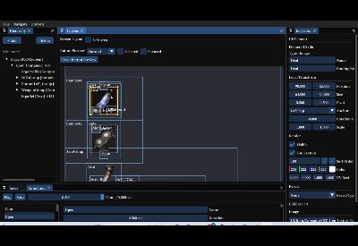 UI 요소 배치와 속성 편집</td>
  </tr>
  <tr>
    <td width="50%" align="center"><b>포즈 레이어</b> 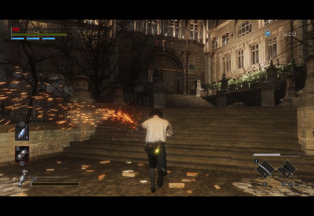 이동 중 무기 연마 동작 합성</td>
    <td width="50%" align="center"><b>장비·코스튬 UI</b> 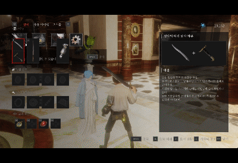 장비 정보와 캐릭터 미리보기</td>
  </tr>
</table>

## 담당 구현 범위

| 영역 | 담당 내용 |
| --- | --- |
| 애니메이션 에디터 | 클립 구간·속도·역재생 설정, Notify·Window, 시퀀스·컨트롤러·포즈 레이어 편집, 프리뷰, JSON 저장·로드 |
| Animator | 상태·조건 평가, 액션 요청, 시퀀스 진행, 블렌딩, 본 마스크·가산 레이어, 루트 모션과 프레임 이벤트 |
| UI 에디터 | 계층·Anchor·Pivot 편집, 이미지·텍스트·버튼·게이지, Nine Slice, 컴포넌트 재사용, Undo/Redo, 애니메이션 편집 |
| UI 런타임 | 에셋 저장·검증·변환, BindingKey, 실행 객체·핸들·수명 관리, 지연 명령, 입력 소유권과 마우스 처리 |
| 게임 UI | 플레이어·몬스터·보스 HUD, 락온, ESC 메뉴, 장비·코스튬·리전 암, 대화·상점·별바라기, 로딩·팝업·사망 화면 |
| 협업 연동 | 팀원의 인벤토리·플레이어·NPC와 UI 연결, 리전 암 강화 조건 일부 수정, 기존 사운드 매니저의 시퀀스 재생 확장 |

팀 공용 코드에는 다른 팀원의 수정도 포함되어 있습니다. 이 문서의 담당 범위는 제가 구현한 기능과 연동 작업을 뜻하며, 플레이어·인벤토리·렌더러·사운드 시스템 전체의 단독 구현을 의미하지 않습니다.

## 주요 구현

### 1. 애니메이션 에디터와 런타임 데이터 연결

<table>
  <tr>
    <td width="50%" align="center"><b>시퀀스 프리뷰</b> 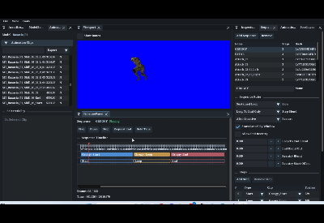 여러 클립의 연결과 재생 흐름 확인</td>
    <td width="50%" align="center"><b>상태 전환 프리뷰</b> 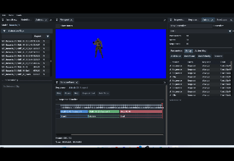 컨트롤러 상태와 애니메이션 전환 확인</td>
  </tr>
</table>

원본 애니메이션을 수정하는 대신, **원본을 참조하는 클립 설정**을 편집하도록 구성했습니다. 하나의 원본 모션에서 프레임 범위·재생 속도·이벤트가 다른 여러 클립을 만들고 시퀀스와 컨트롤러에 연결할 수 있습니다.

- **Clip:** 시작·종료 프레임, 반복·역재생, 기본 속도와 구간별 속도, 루트 모션 사용 여부를 설정합니다.
- **Notify / Window:** 특정 프레임의 이벤트와 일정 프레임 동안 유지되는 콤보·캔슬·게임플레이 구간을 구분합니다.
- **Sequence / Controller:** Start·Loop·End 흐름, 상태·파라미터·액션 요청과 전환 조건을 편집합니다.
- **Preview:** 시퀀스의 루프 종료와 블렌딩, 모델의 실제 루트 이동, 본에 붙는 Notify 슬롯의 위치·방향을 확인합니다.

클립 복제 시 원본 파일을 복사하지 않고 별도의 ExportName과 클립 식별값을 부여했습니다. 같은 모션을 서로 다른 공격 패턴에 사용할 때 설정을 독립적으로 조정할 수 있습니다. 프리뷰와 런타임이 같은 애니메이션 설정을 사용하도록 연결하고 JSON으로 저장·로드합니다.

<b>공개 코드 샘플</b>

- [Animation_EditorContext.cpp](CodeSamples/Private/01_AnimationEditor/Animation_EditorContext.cpp): 클립·Notify·Window·시퀀스 편집과 타임라인 동기화.
- [Preview_Manager.cpp](CodeSamples/Private/01_AnimationEditor/Preview_Manager.cpp): 편집 변경 반영과 시퀀스 프리뷰의 시간 동기화.
- [관련 헤더](CodeSamples/Public/01_AnimationEditor)

### 2. Animator · 블렌딩 · 루트 모션

Animator는 상태와 재생 시간을 관리하고 현재 포즈를 계산합니다. Model은 계산된 포즈를 받아 본 계층과 렌더링에 반영합니다. 상태 판단과 포즈 계산, 모델 표현의 역할을 나눴습니다.

상태 전환에서는 두 포즈를 보간하고, 포즈 레이어에서는 본 마스크에 해당하는 부위에 추가 동작을 적용합니다. 가산 레이어는 기준 포즈와의 차이를 이용해 기존 동작 위에 합성합니다. Notify는 지나간 프레임 구간을, Window는 현재 활성 구간을 평가해 게임 코드에 전달합니다.

#### 루트 모션의 좌표계와 중복 이동 처리

작업 과정에서 루트 본의 로컬 이동을 그대로 사용하면 부모 본 변환과 모델 스케일 때문에 이동량이 맞지 않는 문제가 있었습니다. 본 계층을 반영한 공간에서 이동량을 계산하고, 캐릭터 이동에 전달하는 흐름과 렌더 포즈의 이동 제거를 구분했습니다.

입력 이동과 루트 이동이 중복 적용되는 경로를 정리하고, 실제 스킨 계층을 움직이는 본을 기준으로 선택했습니다. 에디터에서도 모델을 실제로 이동시켜 루트 본·이동량·방향을 확인할 수 있도록 했습니다. 물리 이동 시스템 자체는 팀 공용 구현이며, 제 작업은 루트 모션 계산과 해당 이동 경로의 연동입니다.

<b>공개 코드 샘플</b>

- [Animator.cpp](CodeSamples/Private/02_Animator/Animator.cpp): 프레임 갱신 진입부터 상태·시간·시퀀스·이벤트·포즈 처리.
- [Animator_RootMotion.cpp](CodeSamples/Private/02_Animator/Animator_RootMotion.cpp): 본 계층 계산, 이동·회전 추출과 렌더 포즈 보정.
- [Animator_PoseBlend.cpp](CodeSamples/Private/02_Animator/Animator_PoseBlend.cpp), [Animator_PoseLayer.cpp](CodeSamples/Private/02_Animator/Animator_PoseLayer.cpp): 포즈 보간과 본 마스크·가산 레이어 합성.
- [관련 헤더·애니메이션 자료구조](CodeSamples/Public/02_Animator)

### 3. UI 에디터와 에셋 제작 흐름

<table>
  <tr>
    <td width="50%" align="center"><b>부모·자식 계층 편집</b> 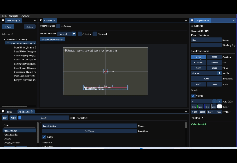 부모 요소와 자식 요소의 배치 관계</td>
    <td width="50%" align="center"><b>Nine Slice</b> 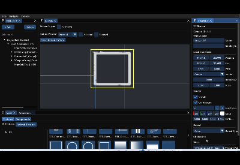 모서리 형태를 유지하는 크기 조절</td>
  </tr>
</table>

초기에는 HUD의 위치·크기·텍스처를 편집한 뒤 레벨 코드에서 다시 조립했습니다. 화면이 늘면서 레벨이 UI의 내부 태그와 생성 규칙까지 알아야 했기 때문에, **UI 에셋에 계층·연결 정보·생성 정책을 저장하고 런타임이 이를 해석하는 구조**로 확장했습니다.

UI 에디터에서 요소 계층과 Anchor·Pivot, 이미지·텍스트·버튼·게이지를 편집합니다. Nine Slice로 모서리를 유지한 이미지 크기 변경을 지원하고, 공통 UI를 Component 에셋으로 만들어 재사용합니다. 드래그 작업을 하나의 편집 단위로 묶는 Undo/Redo와 복사·붙여넣기도 구성했습니다.

사람이 보는 Name과 코드가 찾는 **BindingKey를 분리**해 표시 이름을 바꿔도 연결을 유지하도록 했습니다. 저장 데이터는 Serializer·Validator를 통해 읽고 검사하며, 런타임에서도 같은 에셋 구조를 사용합니다.

<b>공개 코드 샘플</b>

- [UI_EditorContext.cpp](CodeSamples/Private/03_UIEditor/UI_EditorContext.cpp): 에셋 로드·검증·저장과 Undo/Redo 이력 복원.
- [UIAnimationPanel.cpp](CodeSamples/Private/03_UIEditor/UIAnimationPanel.cpp): 재생 제어·키프레임 편집과 보간.
- [관련 헤더](CodeSamples/Public/03_UIEditor)

### 4. UI 수명·입력 관리와 애니메이션

동일한 MonsterHUD 에셋으로 여러 실행 객체를 만들 수 있도록 에셋과 인스턴스를 분리했습니다. 실행 객체는 슬롯과 세대 값을 가진 `UI_HANDLE`로 확인하고, 수명 정책에 따라 정리합니다. 생성·제거 요청은 지연 명령으로 처리해 갱신 중인 컨테이너를 이벤트 콜백에서 바로 변경하지 않도록 했습니다.

몬스터의 생성·제거와 HUD의 연결을 관리하고, 보스 제거·재등장 시 UI 상태도 함께 갱신합니다. 화면과 팝업에는 입력 소유권을 부여해 최상위 UI를 기준으로 입력을 처리합니다. Push·Pop을 지연 반영해 같은 프레임의 입력이 아래 화면까지 연쇄 적용되는 문제를 다뤘습니다. UI 입력 소유권과 게임플레이 입력 차단은 별도 정책입니다.

  <b>UI 애니메이션 편집</b> 
  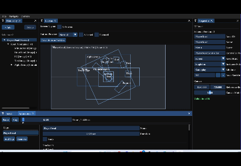 
  키프레임에 따른 UI 속성 변화와 재생 미리보기

`CUIAnimationPlayer`는 키프레임 트랙을 평가해 위치·크기·회전·색상·알파 등을 적용합니다. Step·Linear·Ease 계열 보간을 지원하고, 에디터의 시간 이동과 런타임 재생에서 사용할 수 있게 구성했습니다.

<b>공개 코드 샘플</b>

- [UI_Manager.cpp](CodeSamples/Private/04_UIRuntime/UI_Manager.cpp): 생성·해제 요청, 핸들, 지연 명령과 입력 소유권.
- [UIAssetSerializer.cpp](CodeSamples/Private/04_UIRuntime/UIAssetSerializer.cpp), [UIAssetValidator.cpp](CodeSamples/Private/04_UIRuntime/UIAssetValidator.cpp): 파일 입출력 진입과 요소·애니메이션 검증.
- [UIAnimationPlayer.cpp](CodeSamples/Private/04_UIRuntime/UIAnimationPlayer.cpp): 시간 갱신 → 트랙 평가 → 실제 UI 속성 반영.
- [관련 헤더·UI 자료구조](CodeSamples/Public/04_UIRuntime)

### 5. 게임 상태와 UI 연결

<table>
  <tr>
    <td width="50%" align="center"><b>NPC 상호작용·대화</b> 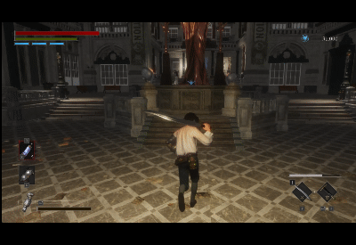 상호작용 안내와 대화 화면 연결</td>
    <td width="50%" align="center"><b>메뉴 선택</b> 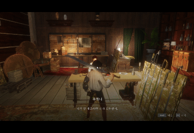 메뉴 항목 선택과 화면 전환</td>
  </tr>
</table>

  <b>별바라기 이동 UI</b> 
  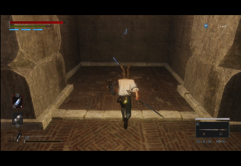 
  별바라기 상호작용과 이동 지점 선택

Controller는 게임 상태와 입력 명령을 연결하고, ViewModel은 화면에 표시할 값을 보관하도록 구성했습니다. 화면 요소는 BindingKey로 찾아 갱신합니다.

| 화면 | 구현·연동 내용 |
| --- | --- |
| 전투 HUD | 플레이어 체력·스태미나, 몬스터·보스 체력, 상태 표시와 락온 |
| 장비 | 카테고리·상세 정보, 코스튬 선택, 장비창 캐릭터 미리보기 |
| 리전 암 | 교체·강화 UI, 보유 상태·강화 조건과 비용 검사 연동 |
| 대화·상점 | NPC 대화 이벤트, 선택·서비스 요청, 상품 목록·선택과 게임 데이터 연결 |
| 별바라기 | 메뉴·이동 지점 선택과 이동 요청 연결 |
| 기타 | ESC 메뉴, 확인창, 아이템 팝업, 상호작용 안내, 로딩 진행률·팁, 사망 화면 |

인벤토리 전체를 새로 작성한 것은 아닙니다. 기존 인벤토리에 UI를 연결하면서 리전 암의 중복 강화 방지·에르고 검사·성공 후 비용 차감 등 필요한 부분을 수정했습니다. 사운드 역시 기존 매니저에 시작·반복·종료 구간의 시퀀스 재생을 확장하고 게임 동작에 연결한 범위로 구분합니다.

<b>공개 코드 샘플</b>

- [UIControllerBase.cpp](CodeSamples/Private/05_GameUI/UIControllerBase.cpp): ViewModel 갱신과 화면 반영의 공통 호출 순서.
- [UIEquipmentController.cpp](CodeSamples/Private/05_GameUI/UIEquipmentController.cpp), [EquipmentViewModel.cpp](CodeSamples/Private/05_GameUI/EquipmentViewModel.cpp): 열기·선택·장착·상태 반영·미리보기·닫기.
- [UIMonsterHUDController.cpp](CodeSamples/Private/05_GameUI/UIMonsterHUDController.cpp): Actor 이벤트와 몬스터별 HUD 생성·갱신·제거.
- [UINPCDialogueController.cpp](CodeSamples/Private/05_GameUI/UINPCDialogueController.cpp): 대화 시작·진행·서비스 요청·종료.
- [관련 헤더](CodeSamples/Public/05_GameUI)

## 게임 플레이 시연

팀 프로젝트 전체 플레이 영상입니다. 아래 장면에서는 담당한 애니메이션 런타임과 UI가 게임에 적용된 모습을 볼 수 있으며, 맵·AI·전투·이펙트 등에는 팀원의 구현이 포함되어 있습니다.

<b>필드·보스 전투 GIF 10개 보기</b>

<table>
  <tr>
    <td width="50%" align="center"><b>필드 플레이 1</b> 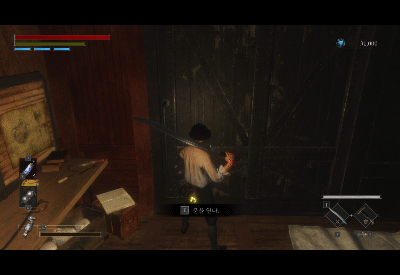 탐색과 상호작용</td>
    <td width="50%" align="center"><b>필드 플레이 2</b> 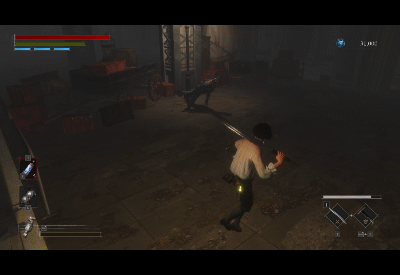 일반 전투</td>
  </tr>
  <tr>
    <td width="50%" align="center"><b>중간 보스 전투</b> 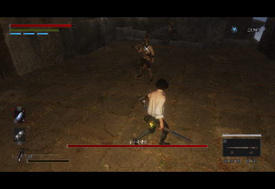 전투 중 애니메이션·HUD 적용</td>
    <td width="50%" align="center"><b>보스 전투 1</b> 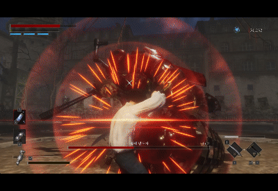 보스전 진행</td>
  </tr>
  <tr>
    <td width="50%" align="center"><b>보스 전투 2</b> 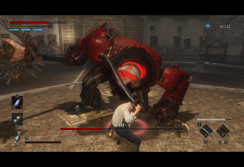 전투와 보스 처치 표시</td>
    <td width="50%" align="center"><b>보스 전투 3</b> 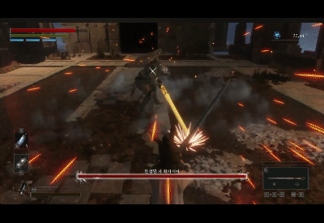 전투 중 동작 전환과 HUD</td>
  </tr>
  <tr>
    <td width="50%" align="center"><b>보스 전투 4</b> 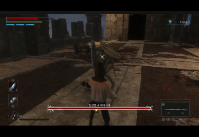 근접 전투</td>
    <td width="50%" align="center"><b>보스 전투 5</b> 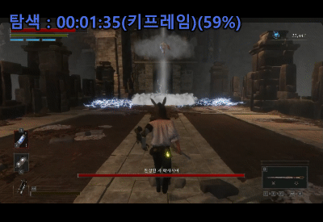 보스전 진행</td>
  </tr>
  <tr>
    <td width="50%" align="center"><b>보스 전투 6</b> 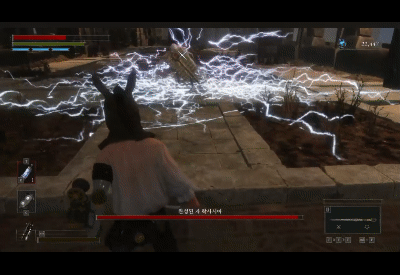 보스전 진행</td>
    <td width="50%" align="center"><b>보스 전투 7</b> 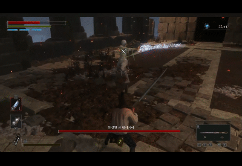 보스전 진행</td>
  </tr>
</table>

## 기술 스택

| 기술 | 담당 기능에서의 활용 |
| --- | --- |
| C++ | 에디터, Animator, UI 런타임·컨트롤러와 데이터 구조 |
| DirectX 11 · HLSL | 애니메이션 프리뷰와 UI 렌더링 연결 |
| DirectXMath | 포즈 보간, 본 변환과 루트 모션 계산 |
| ImGui | 애니메이션·UI 편집 패널 |
| JSON | 애니메이션 설정과 UI 에셋 저장·검증 |
| FMOD | 기존 사운드 시스템의 시퀀스 재생 확장 |

## 코드 공개 범위

핵심 구현을 발췌한 **구현 파일 17개·헤더 19개**를 공개합니다. 구현은 `CodeSamples/Private`, 헤더는 `CodeSamples/Public` 아래에 01~05 기능별로 정리했습니다.

함수의 처리 흐름이 이어지도록 발췌하고, 생략한 부분은 `[중략]`, 팀원 수정이 포함된 함수는 공동 수정으로 표시했습니다. 전체 소스·리소스·공통 의존 코드는 포함하지 않아 **이 저장소만으로 빌드하거나 실행할 수 없습니다.**

## 제작 목적 및 리소스 출처

본 프로젝트는 게임 클라이언트 개발 학습을 위해 제작한 **비영리 교육용 모작**입니다. 원작 리소스는 학습·교육 목적으로 사용했으며, 구현 내용과 학습 결과를 포트폴리오로 정리했습니다.

원작은 **P의 거짓(Lies of P)**이며, 원작 게임의 이미지·모델·음원 등 리소스의 권리는 각 권리자에게 있습니다. 본 프로젝트는 원작의 공식 프로젝트가 아닙니다.
